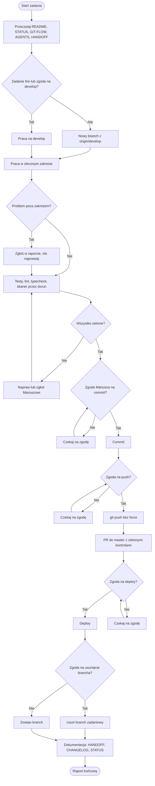

#mariusz/latitude
## Złota zasada
- Przed każdym commitem pełny zestaw testów wymagany przez repozytorium musi być zielony.
- Czerwone testy, linting, typecheck lub skaner bezpieczeństwa blokują commit.
- Jeśli czerwone jest coś niezwiązanego z zadaniem, zgłoś to mnie. Nie omijaj i nie wyłączaj kontroli.
- Nie używaj --no-verify ani innych sposobów pomijania hooków.

## Start zadania
- Przeczytaj: README.md, STATUS.md, GIT-FLOW.md, AGENTS.md, HANDOFF.md.
- Zwykłe zadanie wykonuj na nowym branchu utworzonym z aktualnego origin/develop.
- Nie pracuj bezpośrednio na master ani develop.
- Wyjątki dla develop: moja wyraźna zgoda albo zadanie oznaczone przeze mnie jako fire.

## Commit
- Agent commituje sam.
- Nie zmieniaj git config user.name ani git config user.email.
- Nie cofaj zmian przez git restore, git checkout --, git reset --hard, git clean -f ani podobne mechanizmy bez mojej zgody.
- Nie commituj sekretów, plików .env ani kluczy. Pilnujcie tych sekretów potem jest masa roboty jak wyjdzie na github
- Starannie opisuj by poszukiwaniu za miesiąc coś dał ten komentarz 
- Przed commitem rytuał końca , czyli aktualizowanie plików README.md, STATUS.md, GIT-FLOW.md, AGENTS.md, HANDOFF.md oraz aktualizacja pliku CHANGELOG.md ! WAŻNE
- Obowiązek podpisywania się macie obowiązek podpisywać się w commit przykład   
    `Co-Authored-By: Dostawca Model 5.5 <noreply@model.com>` WAŻNE

## Push, master, deploy
- git push wymaga osobnej, wyraźnej zgody Mariusza w bieżącej rozmowie.
- Nie używaj force push!
- Master przyjmuje zmiany wyłącznie przez PR z zielonymi wymaganymi kontrolami.
- Deploy wymaga osobnej zgody Mariusza.
- Po udanym wdrożeniu gałąź zadaniową można usunąć.

## Koniec zadania (rytuał końca)
- Podaj krótki raport: co zmieniono, jakie testy uruchomiono i z jakim wynikiem, co zostało otwarte.
- Jeśli pliki istnieją i zmiana tego wymaga, zaktualizuj kolejno:
1. HANDOFF.md – krótka pałeczka dla następnej sesji.
2. CHANGELOG.md – trwała historia, append-only.
3. STATUS.md – aktualny stan i następny priorytet. Gdzie jesteśmy teraz . Odpowiedz na pyatanie w jakim momencie prac nad projektem jestesmy teraz i najbliższy krok (ogólnie np dołążyć wysyłkę email).
4. REPO.md – krótkie uwagi o: pułapki, uwagi techniczne jak działa dany ficzer. Coś co trzeba wiedzieć by uniknąć przeszukiwania jak to działa i nie robić błedów.

## PO co to komu? (mem)
README.md – Wizytówka projektu: mówi, czym jest projekt, do czego służy i jak go szybko uruchomić. Jest pierwszym plikiem, który czyta każdy nowy użytkownik lub współpracownik.

STATUS.md – Bieżący stan prac: co działa, co jest w toku, co jest zablokowane i co zostało do zrobienia. Aktualizuje się go często, więc jest migawką "tu i teraz", a nie dokumentacją na stałe.

GIT-FLOW.md – Zasady pracy z Gitem: nazewnictwo gałęzi, format commitów, sposób scalania i wydawania wersji. Dzięki niemu każdy (człowiek lub agent AI) pracuje na repozytorium tak samo.

AGENTS.md – Instrukcja dla agentów AI (np. Codex, Claude Code, Cursor): konwencje kodu, komendy do budowania i testów oraz zakazy, np. dotyczące sekretów. Działa jak README dla maszyn, a jego treść wyznacza agentom uprawnienia i granice.

HANDOFF.md – Notatka przekazania pracy między sesjami, osobami lub agentami: co zrobiono, w jakim stanie jest system i jaki jest następny krok. Pozwala podjąć zadanie bez odtwarzania kontekstu od zera.

CHANGELOG.md – Chronologiczny dziennik zmian między wersjami, zwykle w formacie Keep a Changelog (Added, Changed, Fixed, Removed). Służy do szybkiej oceny, co się zmieniło i czy aktualizacja jest bezpieczna.

Różnice między podobnymi plikami
STATUS.md opisuje stan teraźniejszy, HANDOFF.md przekazuje kontekst na następną sesję, a CHANGELOG.md zapisuje historię.
REPO.md kruczki, pułapki, uwagi techniczne jak działa dany ficzer. Coś co trzeba wiedzieć by uniknąć błędów,  przeszukiwania jak to działa.
README.md jest dla ludzi, a AGENTS.md dla agentów AI.
## Diagram przepływu pracy
# Krótki schemat :
### `pull develop -> newbranch from develop TaskName -> end work, only all tests green ->`  
### `commit -> change branch to develop -> merge TaskName to develop -> push to Github`   

